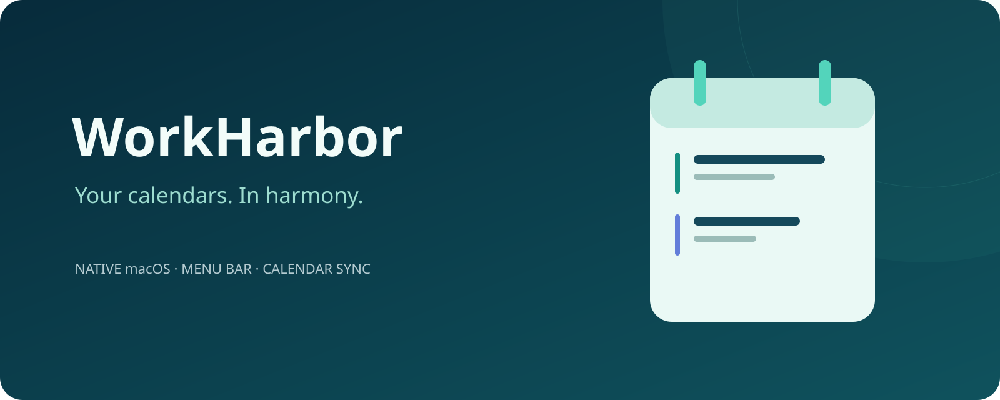
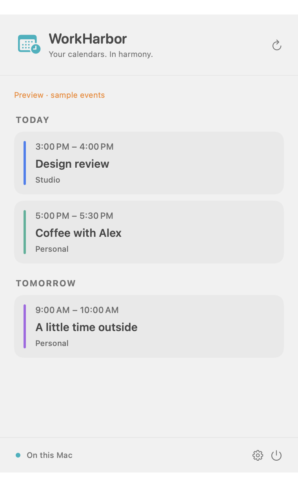
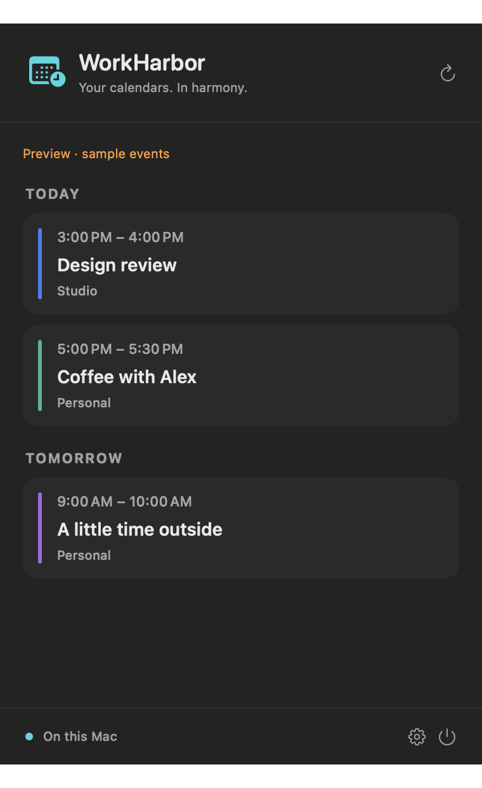

<p align="center"></p>

<p align="center"><a href="README.md">English</a> · <a href="docs/README.pt-BR.md">Português</a> · <a href="docs/README.es.md">Español</a></p>

# WorkHarbor

A quiet home for your calendars, right in the macOS menu bar.

WorkHarbor shows upcoming events and creates controlled copies between calendars already configured in Apple Calendar. No inboxes, embedded browsers, AI accounts, or separate calendar passwords.

> **Development preview.** This is not a notarized production release. Synthetic tests do not establish reliability with every calendar provider. Review changes before enabling automatic synchronization.

## A glance at the menu

<p align="center"> </p>

Native view rendered on macOS with synthetic events. No private calendar data.

## A lighter daily rhythm

- A native SwiftUI menu-bar panel with upcoming events, calendar colors, ongoing events, and day groups.
- A separate settings window for calendar selection and synchronization rules.
- **Busy** copies that share time without titles, notes, or locations; optional before/after buffers.
- Full-detail copies when you explicitly choose to share event details.
- Per-rule automatic synchronization, tied to the exact source, destination, mode, and buffers you approved.
- Reviewed cleanup of identified duplicates, preserving the tracked up-to-date copy.
- English, Brazilian Portuguese, and Spanish interface options.

## How it works

```text
Calendars configured in macOS
          ↓ EventKit
   WorkHarbor on your Mac
          ↓ authorized copies
   Selected destination calendars
```

Your existing Apple Calendar accounts handle provider synchronization. WorkHarbor requires its own Calendar permission; permission granted to Apple's app does not transfer to it. Account restrictions and read-only calendars still apply.

The menu displays the next seven days, up to 80 events. Synchronization examines the previous 30 days and next 180 days. It runs while the app is open and your Mac is awake, including after wake and calendar-change notifications. It is not a cloud service or a real-time remote-delivery guarantee.

## Safety by design

- Copies carry a WorkHarbor marker and are tracked locally. Titles alone never establish ownership.
- A missing source is **not** treated as a deletion. Background synchronization never deletes events.
- Cleanup requires a current tracked copy, explicit selection, and confirmation. Older unmarked copies, other installations, and unmatched identities are not guessed away.
- Cyclic and redundant routes are blocked. A Busy-only destination cannot become the source of another route.
- A durable pending-write journal blocks retries after an uncertain write. Do not delete it to force a retry.
- Existing identities, rules, and inventory are preserved when migrating from earlier previews. Retired mail data and credentials are not loaded or deleted by the calendar-only app.

## Build on macOS

Requirements: macOS 14 or later and Xcode/Swift 6 tooling. No third-party Swift dependencies.

```sh
./scripts/test.sh
./scripts/build-app.sh
```

The script creates an ad-hoc-signed local app and ZIP under `dist/`. Ad-hoc signing is not Apple notarization. Quit an older WorkHarbor instance before opening a new build. Never bypass system security warnings to run an untrusted download.

## Privacy

Calendar access stays in EventKit on your Mac. WorkHarbor has no analytics, email reader, AI endpoint, or calendar backend. Calendar copies can be transmitted by macOS to the providers of the destination accounts you select. Full-detail rules include titles, notes, and locations; Busy rules do not.

Do not post calendar exports, account identifiers, secrets, or private events in issue reports. Use synthetic examples.

## Project status

The menu-bar redesign is under validation. Provider behavior, notification timing, time-zone edge cases, and accessibility need continued testing. Visual assets are original vector artwork; promotional artwork is illustrative, not proof of a running feature.

License has not yet been selected. No redistribution license is implied.
