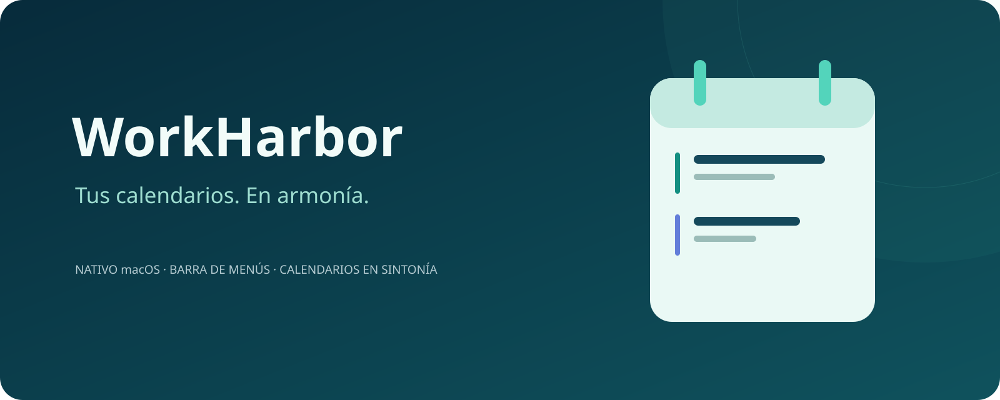
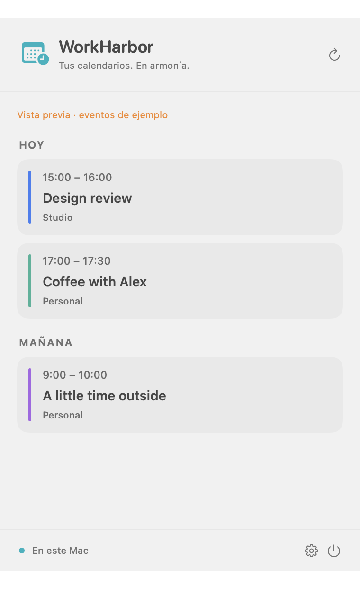
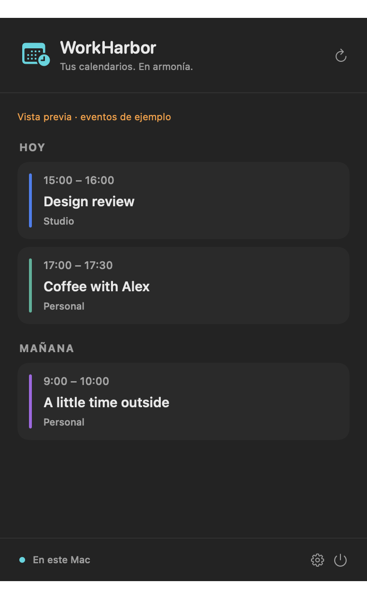

<p align="center"></p>

<p align="center"><a href="../README.md">English</a> · <a href="README.pt-BR.md">Português (Brasil)</a> · <a href="README.es.md">Español</a></p>

<p align="center">macOS 14+ · SwiftUI nativo · Apple EventKit · Licencia MIT</p>

# Tu día a la vista. Tus calendarios en armonía.

WorkHarbor lleva tus próximos eventos a la barra de menús de macOS y ayuda a que tus calendarios trabajen juntos. Consulta lo que viene, mantén a la vista agendas distintas y reserva tiempo personal en el calendario de trabajo sin revelar los detalles.

Pensado para quienes no tienen toda su vida en un solo calendario. Sin una nueva cuenta de calendario. Sin contraseñas adicionales. Solo los calendarios que ya están en tu Mac.

**[Empezar](#empezar)** · **[Cómo funciona la sincronización](synchronization.md)** · **[Contribuir](../CONTRIBUTING.md)**

> **Versión preliminar en desarrollo:** compila desde el código fuente en macOS. Las compilaciones locales llevan firma ad hoc, sin notarización; prueba con calendarios desechables antes de depender de la sincronización.

## Más claridad para tu día

<p align="center"> </p>

<p align="center"><em>Interfaz nativa de macOS, presentada con eventos ficticios.</em></p>

### Un vistazo, menos cambios de aplicación

Abre el panel de la barra de menús para consultar eventos agrupados por día, con los colores de cada calendario y una indicación de lo que está ocurriendo ahora. Elige qué calendarios aparecen y deja la configuración en una ventana independiente.

### Comparte tu disponibilidad, no tus planes personales

Crea copias **Busy** en otro calendario sin el título, las notas ni la ubicación del evento original. Añade márgenes antes y después de los eventos con hora para desplazamientos, preparación o una pausa entre compromisos.

### Lleva los detalles adonde los necesitas

Elige **Detalles completos** para las rutas que deban incluir títulos, horarios, notas y ubicaciones. Cada ruta tiene un origen y un destino explícitos: tú decides qué va a cada calendario.

### Revisa primero. Automatiza cuando quieras.

Consulta los cambios propuestos antes de aplicarlos y, si lo prefieres, activa la sincronización automática de esa ruta. La sincronización en segundo plano crea y actualiza copias; nunca elimina eventos.

Modos claro y oscuro. Interfaz en español, inglés y portugués brasileño. Una aplicación nativa que está a mano sin ocupar tu espacio de trabajo.

## Haz que tus calendarios trabajen juntos

1. **Usa tus calendarios actuales.** Configura las cuentas en el Calendario de Apple y concede a WorkHarbor su propio permiso de acceso.
2. **Elige tu vista.** Muestra todos los calendarios en el menú o selecciona solo los que necesitas.
3. **Crea una ruta unidireccional.** Elige un origen, un destino con permiso de escritura y el modo Busy o Detalles completos.
4. **Comprueba el resultado.** Revisa las copias propuestas antes de confirmar los cambios.
5. **Mantén el control manual o activa la sincronización automática.** El permiso se aplica solo a la configuración exacta de la ruta que apruebes.

Por ejemplo: mantén una cita personal visible en tu agenda y muestra únicamente un bloque Busy en el calendario de trabajo. WorkHarbor crea copias independientes, no una sincronización bidireccional entre calendarios.

## Empezar

Necesitas **macOS 14 o posterior** y **Xcode o Command Line Tools con Swift 6**. No hay dependencias externas de paquetes Swift.

```sh
git clone https://github.com/bloodf/workharbor.git
cd workharbor
./scripts/test.sh
./scripts/build-app.sh
open dist/WorkHarbor.app
```

El script genera `dist/WorkHarbor.app` y `dist/WorkHarbor.zip`. Cierra cualquier instancia abierta de WorkHarbor antes de iniciar la nueva compilación. No eludas los avisos de seguridad de macOS para abrir una descarga que no sea de confianza. Para crear paquetes de distribución, consulta la [guía de releases y empaquetado](RELEASING.md).

¿Prefieres explorar la interfaz sin conectar un calendario? Después de compilar, abre el modo de demostración:

```sh
dist/WorkHarbor.app/Contents/MacOS/WorkHarbor --synthetic-demo
```

Este modo utiliza eventos ficticios y bloquea el acceso a calendarios reales.

## Local por diseño. Transparente al compartir.

WorkHarbor utiliza EventKit de Apple en tu Mac, sin cuenta propia, analítica ni servidor de calendarios del proyecto. Tus proveedores siguen gestionando la sincronización remota, y las copias se comparten según los permisos del calendario de destino.

- **Tú eliges los detalles:** Busy oculta el título, las notas y la ubicación originales; Detalles completos comparte esa información.
- **Tú eliges la automatización:** activa o pausa cada ruta de forma independiente.
- **Cambios conservadores:** el seguimiento de copias, la validación de rutas y la limpieza revisada de duplicados ayudan a evitar cambios no deseados.

El menú muestra hasta 80 eventos de los próximos siete días. La sincronización abarca los 30 días anteriores y los 180 siguientes, con la aplicación abierta y el Mac despierto. La compatibilidad con proveedores y los tiempos de entrega remota requieren pruebas; no es un servicio en la nube siempre activo.

Consulta la [guía de sincronización](synchronization.md), las [notas de privacidad](privacy.md) y la [guía de soporte](../SUPPORT.md) para conocer los límites importantes. La documentación técnica está en inglés.

## Construyámoslo juntos

Ayuda a mejorar un compañero de calendario de código abierto, centrado en lo esencial. Son bienvenidos los informes de errores reproducibles, las mejoras de accesibilidad, las traducciones, las pruebas y los retoques de la interfaz nativa.

- [Guía de contribución](../CONTRIBUTING.md)
- [Informar de un error o proponer una mejora](https://github.com/bloodf/workharbor/issues/new/choose)
- [Arquitectura](architecture.md) · [Historial de cambios](../CHANGELOG.md)
- [Código de conducta](../CODE_OF_CONDUCT.md) · [Política de seguridad](../SECURITY.md)

Si WorkHarbor encaja en tu rutina, deja una estrella en el proyecto y ayuda a otras personas a encontrarlo.

## Licencia

[MIT](../LICENSE) · Copyright © 2026 Heitor Ribeiro.


El clic principal abre la agenda. Un clic secundario (incluido el gesto configurado del trackpad) o Control-clic abre opciones rápidas de agenda, configuración, actualización y salida. VoiceOver ofrece la acción Opciones rápidas.
