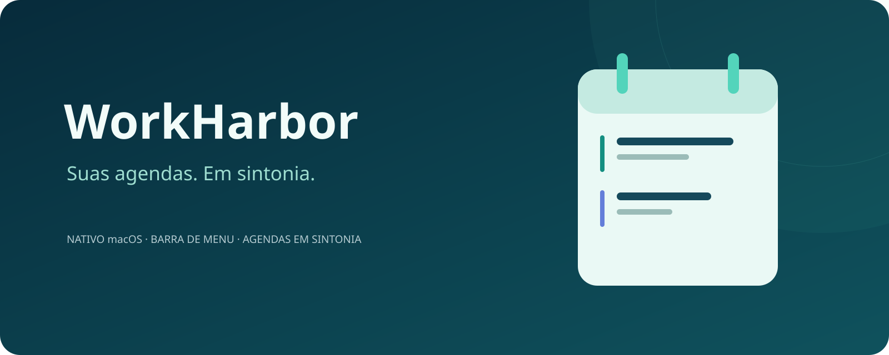
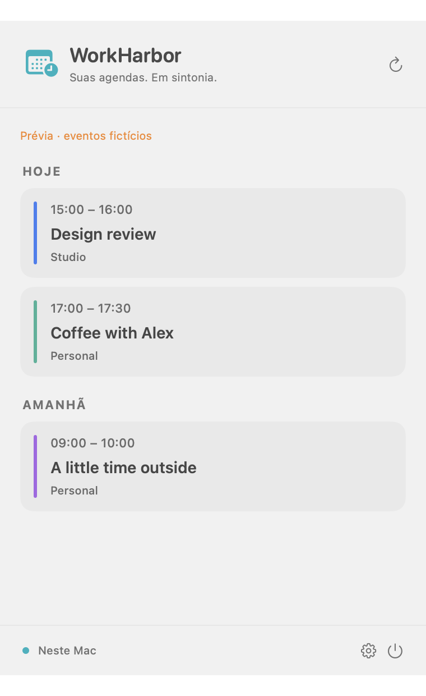
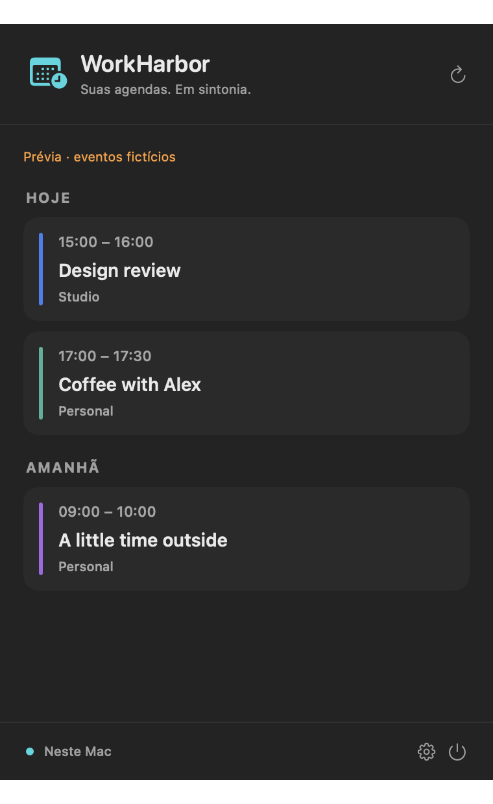

<p align="center"></p>

<p align="center"><a href="../README.md">English</a> · <a href="README.pt-BR.md">Português (Brasil)</a> · <a href="README.es.md">Español</a></p>

<p align="center">macOS 14+ · SwiftUI nativo · Apple EventKit · Licença MIT</p>

# Seu dia à vista. Suas agendas em sintonia.

O WorkHarbor traz seus próximos compromissos para a barra de menus do macOS e ajuda suas agendas a trabalhar juntas. Veja o que vem a seguir, acompanhe agendas diferentes e reserve seu tempo pessoal no calendário de trabalho sem revelar os detalhes.

Feito para quem não cabe em uma agenda só. Sem uma nova conta de calendário. Sem senhas adicionais. Apenas as agendas que já estão no seu Mac.

**[Começar](#começar)** · **[Como funciona a sincronização](synchronization.md)** · **[Contribuir](../CONTRIBUTING.md)**

> **Prévia em desenvolvimento:** compile a partir do código-fonte no macOS. As compilações locais usam assinatura ad hoc, sem notarização; teste com calendários descartáveis antes de depender da sincronização.

## Mais clareza para o seu dia

<p align="center"> </p>

<p align="center"><em>Interface nativa do macOS, apresentada com eventos fictícios.</em></p>

### Uma olhada, menos troca de aplicativos

Abra o painel na barra de menus para ver os próximos eventos agrupados por dia, com as cores de cada calendário e indicação do que está acontecendo agora. Escolha quais agendas aparecem e mantenha os ajustes em uma janela separada.

### Compartilhe sua disponibilidade, não sua vida pessoal

Crie cópias **Busy** em outro calendário sem o título, as notas ou o local do evento original. Acrescente intervalos antes e depois de eventos com horário para deslocamento, preparação ou uma pausa entre compromissos.

### Leve os detalhes para onde fazem sentido

Escolha **Detalhes completos** para as rotas que devem incluir títulos, horários, notas e locais. Cada rota tem origem e destino explícitos: você decide o que vai para cada agenda.

### Revise primeiro. Automatize quando quiser.

Veja as alterações propostas antes de aplicá-las e, se preferir, ative a sincronização automática daquela rota. A sincronização em segundo plano cria e atualiza cópias; nunca exclui eventos.

Modos claro e escuro. Interface em português brasileiro, inglês e espanhol. Um aplicativo nativo que fica por perto sem ocupar o seu espaço de trabalho.

## Faça suas agendas trabalharem juntas

1. **Use suas agendas atuais.** Configure as contas no Calendário da Apple e conceda ao WorkHarbor a própria permissão de acesso.
2. **Escolha sua visualização.** Mostre todas as agendas no menu ou selecione apenas as que precisa acompanhar.
3. **Crie uma rota de mão única.** Escolha uma origem, um destino com permissão de escrita e o modo Busy ou Detalhes completos.
4. **Confira o resultado.** Revise as cópias propostas antes de confirmar as alterações.
5. **Mantenha o controle manual ou ative o automático.** A autorização vale somente para a configuração exata da rota que você aprovar.

Por exemplo: mantenha um compromisso pessoal visível na sua agenda e mostre apenas um bloco Busy no calendário de trabalho. O WorkHarbor cria cópias separadas, não uma sincronização bidirecional entre agendas.

## Começar

Você precisa de **macOS 14 ou superior** e **Xcode ou Command Line Tools com Swift 6**. Não há dependências externas de pacotes Swift.

```sh
git clone https://github.com/bloodf/workharbor.git
cd workharbor
./scripts/test.sh
./scripts/build-app.sh
open dist/WorkHarbor.app
```

O script gera `dist/WorkHarbor.app` e `dist/WorkHarbor.zip`. Encerre qualquer instância aberta do WorkHarbor antes de iniciar a nova compilação. Não contorne os avisos de segurança do macOS para abrir um download não confiável. Para pacotes de distribuição, consulte o [guia de releases e empacotamento](RELEASING.md).

Quer conhecer a interface sem conectar um calendário? Após compilar, abra o modo de demonstração:

```sh
dist/WorkHarbor.app/Contents/MacOS/WorkHarbor --synthetic-demo
```

Esse modo usa eventos fictícios e bloqueia o acesso a calendários reais.

## Local por princípio. Transparente ao compartilhar.

O WorkHarbor usa o EventKit da Apple no seu Mac, sem conta própria, analytics ou servidor de calendários do projeto. Seus provedores continuam responsáveis pela sincronização remota, e as cópias ficam disponíveis conforme as permissões do calendário de destino.

- **Você escolhe os detalhes:** Busy oculta o título, as notas e o local originais; Detalhes completos compartilha essas informações.
- **Você escolhe a automação:** ative ou pause cada rota de forma independente.
- **Alterações conservadoras:** rastreamento de cópias, validação de rotas e limpeza revisada de duplicatas ajudam a evitar mudanças indesejadas.

O menu mostra até 80 eventos nos próximos sete dias. A sincronização cobre os 30 dias anteriores e os 180 seguintes, com o aplicativo aberto e o Mac acordado. A compatibilidade com provedores e o tempo de entrega remota precisam de testes; não é um serviço de nuvem sempre ativo.

Consulte o [guia de sincronização](synchronization.md), as [notas de privacidade](privacy.md) e o [guia de suporte](../SUPPORT.md) para conhecer os limites importantes. A documentação técnica está em inglês.

## Construa com a gente

Ajude a melhorar um companheiro de calendário open source, feito para fazer bem o essencial. Relatos reproduzíveis de bugs, melhorias de acessibilidade, traduções, testes e refinamentos da interface nativa são contribuições bem-vindas.

- [Guia de contribuição](../CONTRIBUTING.md)
- [Relatar um bug ou sugerir uma melhoria](https://github.com/bloodf/workharbor/issues/new/choose)
- [Arquitetura](architecture.md) · [Histórico de alterações](../CHANGELOG.md)
- [Código de conduta](../CODE_OF_CONDUCT.md) · [Política de segurança](../SECURITY.md)

Se o WorkHarbor combina com sua rotina, deixe uma estrela no projeto e ajude outras pessoas a encontrá-lo.

## Licença

[MIT](../LICENSE) · Copyright © 2026 Heitor Ribeiro.


O clique primário abre a agenda. Clique secundário (inclusive o gesto configurado no trackpad) ou Control-clique abre opções rápidas de agenda, configurações, atualização e saída. O VoiceOver oferece a ação Opções rápidas.
